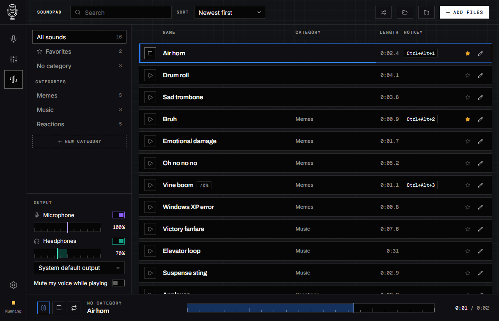

<p align="center">
  <picture>
    <source media="(prefers-color-scheme: dark)" srcset="assets/branding/macafon-wordmark-white.svg">
    
  </picture>
</p>

<p align="center">
  <b>Microphone processing, per-app mixer, soundpad and local dictation for Windows 11.</b>
</p>

<p align="center">
  
  
  
</p>


## Features

**Microphone.** Your microphone goes through Gain → High-pass → noise suppression → Expander → EQ →
Compressor → De-esser → Limiter and comes out as a virtual microphone for Discord, OBS, Zoom or games.

- One-click calibration tunes the chain to your room and voice.
- Record a clip and switch **Before ⇄ After** to hear every change.
- AI noise suppression runs locally: *Lite* (RNNoise) or *Studio* (DeepFilterNet 3).
- Built-in and custom presets, a fallback microphone, per-microphone settings.

**Mixer.** Apps appear automatically; drag them between channels (Main, Voice, Music, up to eight) to
control their volume with one fader. Pick the output device or a priority list for automatic switching.
Your soundpad's headphone playback is an app of its own, so it goes into any channel too.


**Soundpad.** Play sounds into your voice chat — you hear them in your headphones too.

- Drop audio files on the window or into the library folder — `Music\Macafon Sounds` or any folder on
  any drive. Each subfolder is a category: new folders show up in the app, and moving a sound to
  another category moves its file.
- Sounds are loudness-normalized: at 100 % they are about as loud as your voice, and a limiter keeps
  the voice chat from clipping.
- MP3, WAV, OGG, FLAC, M4A, AAC. Search, sort, favorites, per-sound volume and hotkeys; large libraries
  load in the background.
- Your voice processing is not applied to sounds. Optionally mute your voice while a sound plays.



**Dictation.** Hold `Ctrl+Win`, speak, release — the text appears in the window you were typing in,
like Wispr Flow, but free and fully offline. English, Ukrainian and Russian.

- Two local engines: **Whisper** (whisper.cpp, the most accurate for Ukrainian and Russian) and
  **Parakeet** (NVIDIA Parakeet TDT v3, fast on the CPU). Whisper runs on any GPU through Vulkan —
  ten seconds of speech in about a third of a second — and falls back to the CPU. Models are downloaded from Hugging Face only when you
  click *Get*, checked by SHA-256 and kept in any folder you choose.
- The keyboard layout of the target window decides between Ukrainian and Russian; or fix the language.
- `Ctrl+Win+Space` dictates hands-free, `Shift+Alt+Z` pastes the last result again, `Shift+Alt+X`
  copies it, `Ctrl+Win+Shift` dictates to the clipboard only.
- Costs nothing while unused: the speech worker starts on the key press, runs at low priority and
  unloads after a few minutes. Your voice chat does not hear you dictate.
- Two popups: a Flow-style pill with level bars, or a vintage VU meter.


**Always at hand.** Global hotkeys (push-to-talk, mute, volume, sounds; left and right Ctrl/Alt are
told apart) work with the window closed and show a small on-screen popup. The tray icon opens a quick
panel; `LCtrl+LAlt+Z` opens an overlay with volumes and a searchable soundpad. **Doctor** checks your
audio setup.

<details>
<summary>More screenshots</summary>
<br>

<p align="center">
  <br>
  <sub><b>Hotkey overlay</b> (<code>LCtrl+LAlt+Z</code>): channel volumes, microphone, processing and preset over any app.</sub>
</p>

<p align="center">
  <br>
  <sub><b>Overlay with sounds</b>: the round button opens the soundpad — search, categories, one click to play.</sub>
</p>

<p align="center">
  <br>
  <sub><b>Tray panel</b> (right-click the tray icon): quick toggles, preset and volumes.</sub>
</p>

<p align="center">
  <br>
  <sub><b>Settings → Hotkey popup</b>: pick the popup style, edge and monitor from pictures of where it appears.</sub>
</p>

<p align="center">
  <br>
  <sub><b>Settings → Soundpad</b>: use any folder on any drive as the sound library.</sub>
</p>

</details>

## Install on Windows 11

1. Download `Macafon_*_x64-setup.exe` from the [latest release](https://github.com/Mar1kLab/Macafon/releases/latest).
   No administrator rights needed.
2. Install the free [VB-CABLE](https://vb-audio.com/Cable/) driver (run `VBCABLE_Setup_x64.exe` as
   administrator, then reboot). Macafon uses it as your virtual microphone.
3. Open Macafon and follow the setup: microphone, calibration, mixer.
4. In Discord, OBS or Zoom select **CABLE Output (VB-Audio Virtual Cable)** as the microphone.

Macafon must keep running in the tray — without it the cable is silent. Uninstalling restores your
original audio devices and app volumes.

## Linux (experimental)

The PipeWire backend creates its own virtual microphone and supports channel EQ and effects, but is
less tested. Soundpad is Windows-only for now. Requires PipeWire ≥ 1.0 and WirePlumber ≥ 0.5.

```sh
sudo apt install build-essential pkg-config libclang-dev libpipewire-0.3-dev pipewire-bin \
                 libwebkit2gtk-4.1-dev libgtk-3-dev libdbus-1-dev
corepack pnpm -C apps/macafon-ui install --frozen-lockfile
python3 tools/package-linux.py     # deb, rpm and AppImage in target/release/bundle/
```

## Command line

```sh
macafon ctl status
macafon ctl preset broadcast            # natural, discord-clear, noisy-room, broadcast, warm-podcast, raw
macafon ctl mic mute toggle
macafon ctl channel voice volume +5
macafon ctl soundpad list
macafon ctl soundpad play "Memes/airhorn.mp3"
macafon ctl soundpad stop
macafon ctl dictation toggle            # on, off, toggle
macafon ctl doctor
```

## Build from source (Windows)

Needs stable Rust, Node.js 24, Python 3.12+, CMake, LLVM/libclang (set `LIBCLANG_PATH` if it is not
found) and the [Tauri prerequisites](https://v2.tauri.app/start/prerequisites/#windows). CMake and
libclang build the dictation engines (whisper.cpp, sherpa-onnx); the GPU build of Whisper also needs
the [Vulkan SDK](https://vulkan.lunarg.com/) (`VULKAN_SDK`, for `glslc`).

```powershell
corepack enable
corepack pnpm -C apps/macafon-ui install --frozen-lockfile
python tools/package-windows.py            # installer in target/release/bundle/nsis/
python tools/package-windows.py --install  # build and install
```

The UI also runs in a browser with a mock daemon, no audio stack needed:

```sh
corepack pnpm -C apps/macafon-ui dev       # http://127.0.0.1:1420/?platform=windows
```

Contributors: start with [AGENTS.md](AGENTS.md). Requirements are in the [PRD](docs/PRD.md), the
visual language in the [design system](docs/design/design-system.md), architecture decisions in
[docs/adr](docs/adr/).

| Path | Purpose |
|---|---|
| `apps/macafond` | Background daemon: audio, tray, hotkeys |
| `apps/macafon-cli` | `macafon` command line |
| `apps/macafon-ui` | Svelte 5 + Tauri v2 UI |
| `crates/macafon-dsp`, `macafon-studio`, `macafon-engine` | DSP chain, noise suppression, audio engine |
| `crates/macafon-soundpad` | Sound library, decoding, playback |
| `crates/macafon-stt`, `apps/macafon-stt` | Dictation engines and the on-demand speech worker |
| `crates/macafon-backend*` | Windows (WASAPI) and Linux (PipeWire) backends |
| `crates/macafon-ipc`, `macafon-config`, `macafon-apps` | Protocol, settings, app rules |

## Privacy and license

Everything runs locally: no accounts or telemetry. The only network requests are the dictation model
downloads you start yourself (from Hugging Face); audio and dictated text never leave your computer.

[GPL-3.0-only](LICENSE); `macafon-dsp` and `macafon-studio` are MIT OR Apache-2.0. Noise suppression uses
[RNNoise](https://github.com/jneem/nnnoiseless) and [DeepFilterNet](https://github.com/Rikorose/DeepFilterNet).
Dictation uses [whisper.cpp](https://github.com/ggml-org/whisper.cpp) with OpenAI Whisper models and
[sherpa-onnx](https://github.com/k2-fsa/sherpa-onnx) with NVIDIA Parakeet TDT 0.6B v3 (CC-BY-4.0).
VB-CABLE is a separate product by [VB-Audio](https://vb-audio.com/) and is not bundled.
